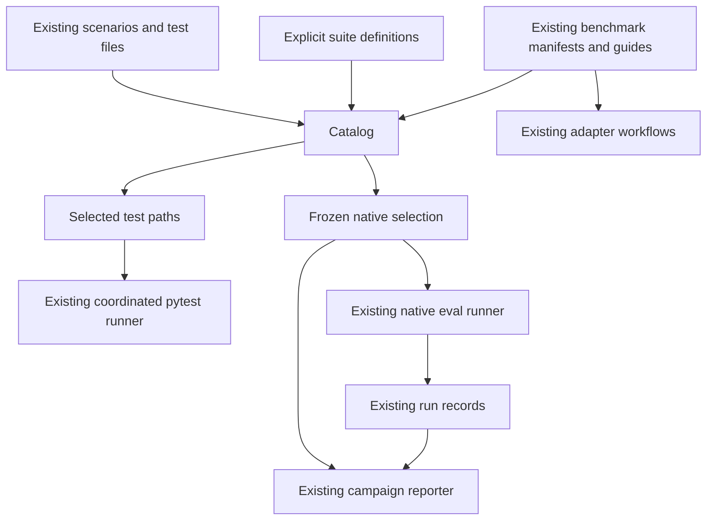

# Test and evaluation discovery and selection design

Build a small catalog and explicit named suites over the existing tests and scenarios. Keep pytest,
the native runner, benchmark adapters, case definitions, and evidence directories in place. A suite
helps a maintainer choose work; a frozen campaign selection records exactly what is to be measured.

The owner selected **discovery and selection first**, with fingerprints established after the
organization and definitions are finalized. Preserving today's hashes is not a design requirement.
The owner subsequently authorized implementation from refreshed main. Initial design evidence was
gathered at `253152cce96fdd3d8c9c059d1ad2eec9ed7586f0` on 2026-10-25; implementation used the newer
`4d9d368d` base. The [implementation record](discovery-and-selection-implementation.md) records the
completed work and checks. This design does not authorize live execution. Delivery status continues
to belong to [the fleet roadmap](../fleet-roadmap.md).

## Problem and evidence

The later owner-approved coverage expansion assigns all current native cases and root tests,
indexes other runners and planned/proposal tracks, and adds a capability map. The initial five-suite
rollout below describes the first increment; the [coverage guide](../../evals/docs/coverage.md)
describes the expanded inventory. New cases/tests now require an explicit suite assignment.

[verified] At the initial design baseline, the checkout had 143 Python test files across `scripts/` and `evals/`. Native
validation reports 399 scenarios and 2,250 graded expectations: 178 build, 115 contract, 105 routing,
and one native-kind scenario. These are file, scenario, and expectation counts, not a count of
independent capabilities or successful model trials.

[verified] At that baseline, the [eval guide](../../evals/README.md) was 1,014 lines. It combined first-run instructions,
case explanations, provenance, runner internals, and historical campaign context. The native
[CLI](../../evals/probe/cli.py) selected one exact ID or every scenario. The
[pytest configuration](../../pytest.ini) selects repository tests, and the root
[collection hooks](../../conftest.py) implement the default/heavy distinction.

[verified] Recent additions make a directory-only design insufficient. ITBench, SWE-bench, SWT,
and Harbor have their own adapters and manifests; the
[campaign reporter](../../evals/campaign_report.py) already accepts explicit selected tasks. Incident
conversations are an additional profile: several are classified as routing by the existing
`scenario_kind` function. A catalog that equates “conversation” with `kind=native` would hide them.

[verified] [Case fingerprints](../../evals/probe/fingerprints.py) include the parsed scenario mapping,
referenced oracle bytes, and rubric definitions. Adding organizational tags to scenario YAML changes
case identity. Harness fingerprints also include every Python module under `evals/probe/`.
These facts govern how future results are recorded, not which organizational changes are allowed.
Make the useful organizational changes first, then compute identities for the finalized definitions.
Existing results retain their original fingerprints; do not rewrite them to appear to have run
against the new definitions. Changed identities can require a new measurement baseline, but this
design does not authorize live runs merely to establish one.

[sourced] The [one-runner decision](../decisions/2026-09-03-one-eval-runner.md) deliberately removed
split-based selection after it disagreed with documented run cadence. The design must make selected
membership visible rather than recreate that ambiguity. Accepted decisions remain unchanged; the
new native selection input needs a narrow proposed successor before implementation.

## Goals and boundaries

A maintainer should be able to answer four questions from one starting point:

1. What tests or eval cases exist for the work I changed?
2. Which offline checks can I run together, and which require a separate environment?
3. Which exact cases and trial slots would a proposed live run measure?
4. Where are the authoritative run instructions and saved results?

The first release keeps all existing source paths, scenario IDs, pytest node IDs, full-suite
defaults, CI shards, run layouts, and grading semantics. It introduces no new dependency, hosted
service, database, background process, model judge, or generic execution framework. It does not
infer a sufficient regression suite from a Git diff, estimate dollar cost from turn limits, or
declare that a passing suite accepts a candidate.

Python remains compatible with 3.12 and development/tests use the repository's 3.14 environment.
Existing requirements files and Windows/POSIX execution conventions remain authoritative.

## Options and recommendation

| Approach | Benefit | Cost and limitation | Reversibility |
|---|---|---|---|
| Leave execution unchanged and shorten the documentation | Smallest change; improves first-run navigation | Finding related cases and rebuilding selections remains manual | Fully reversible |
| Derive a catalog and add explicit suites plus frozen native selections | Makes existing coverage discoverable and repeatable across workflows | A small registry needs maintenance; native selection adds a bounded CLI contract | Additive; old commands remain available |
| Reorganize tests and scenarios into a new directory taxonomy | Makes filesystem browsing more structured | Changes imports, collection, paths, and links without solving cross-cutting membership | Reversible in Git, but disruptive to consumers |

Recommend the second approach. The owner selected its discovery-first scope; the interface details
below are design proposals. Documentation-only work is the useful first increment. Physical moves
are deferred until a concrete import, collision, or navigation problem remains after this change.

## Three distinct objects

| Object | Purpose | Authority and lifetime |
|---|---|---|
| Catalog | A derived view of current native scenarios, test files, suites, and linked campaigns | Read-only, generated on demand from this checkout; no checked-in copy of the full inventory |
| Suite | A maintained group for a specific workflow, such as Python craft or read-only guard work | Explicit membership in a small JSON document; can evolve through ordinary reviewed changes |
| Campaign selection | Exact case identities and expected trial slots for one native measurement | Frozen JSON beside the private run bundle; later suite changes do not change it |



Catalog results and suite membership are not evidence that the tests are sufficient. A suite can
span fast and heavy files; execution cost remains an independent concern controlled by pytest.
Proposal, held-out, and manual-review status stay explicit where the source declares them. Missing
status is unknown, never accepted by inference.

## Catalog and suite contracts

Add `evals/catalog.py` as a small command-line module outside the measured `probe/` package. It owns
suite parsing and derived inventory presentation. It never launches tests, models, Docker, Git
network commands, or benchmark downloads. Its only write is an explicitly requested selection file.
Native listing and export reuse `probe.catalog` and `probe.fingerprints`; test-only queries avoid
importing native runner modules or optional benchmark SDKs.

Suite documents live under `evals/suites/`, one JSON file per stable workflow name. Separate suite
documents express many-to-many membership across tests, native scenarios, and external campaigns;
their location is not a workaround for preserving existing hashes. JSON is already
used by campaign selections and can be read with the standard library. The following is an
illustrative two-case suite, not a claim of complete Python coverage:

```json
{
  "schema_version": 1,
  "id": "python-refactoring",
  "summary": "Python refactoring judgment and artifact controls",
  "tests": [
    "evals/test_python_craft_oracle.py",
    "evals/test_python_package_refactor.py"
  ],
  "native_scenarios": [
    "python-refactoring-judgment",
    "build-python-package-refactor"
  ],
  "campaigns": [],
  "guides": ["evals/README.md"]
}
```

Each campaign reference contains only `id`, `entrypoint`, `selection`, and `guide`, with repository
paths pointing to the existing adapter and its authoritative artifacts. It does not copy task IDs,
dataset revisions, admission decisions, credentials, runtime flags, or source hashes from them.
The catalog presents these as linked campaigns, not as native scenarios it can execute or export.

The schema is closed and versioned. Reject duplicate JSON keys, unsupported versions, duplicate
members within a suite, missing referenced files/IDs, unsafe paths, and mismatched filename/suite
IDs. Test entries must be existing repository test files under `scripts/` or `evals/`; no directory,
glob, node selector, arbitrary command, or external sandbox path is accepted. Paths must resolve
within the checkout and traverse no symlink. At least one test, native case, or campaign is required.

Membership is explicit. No inheritance, nested suites, runtime filename globs, or negation language
is introduced. Overlap between suites is legitimate; selecting multiple suites forms a deduplicated
union, sorted by repository-relative path for tests and by case ID for native cases. Each result
retains the suite names that selected it. Adding an unrelated file cannot expand an existing suite.

Start with five suites: `readonly-guard`, `eval-harness`, `python-craft`, `incident-conversations`, and
`swebench`. These exercise script tests, harness tests, cross-kind cases, conversation profiles, and
an external adapter respectively. Review explicit membership against the existing relevant tests
and guides during implementation. Do not require every file or case to belong to a suite: the
derived catalog remains exhaustive for native cases and repository test files, and reports those
with no suite. Add other suites when a recurring workflow needs one.

### Commands and query semantics

Proposed commands, with `python` meaning the verified project interpreter:

```bash
python evals/catalog.py suites
python evals/catalog.py list --component skill:python-craft
python evals/catalog.py list --profile incident-v1
python evals/catalog.py show --suite python-craft
python evals/catalog.py tests --suite python-craft --json
python evals/catalog.py campaigns
python evals/catalog.py check
```

`list` covers current native scenarios only. Rows expose ID, source path, existing runner kind,
primary component, routing expectation, conversation profile, declared partition, manual-review
state, maximum turns, and suite membership. `profile` is separate from `kind`; the catalog does not
reinterpret the runner's classification. `--component agent:NAME` and `--component skill:NAME` match
the pinned agent/skill or the routing target, including negative routing targets. They do not claim
to find every helper or indirectly loaded skill. Use an explicit suite for those cross-cutting cases.

Support exact `--kind`, `--component`, `--profile`, and `--suite` discovery filters. Repeated values
within a dimension are OR; dimensions combine with AND. With no filters, list the whole native
catalog. List order is lexical by ID. No free-text query language, regex selector, or implicit split
filter is needed. Unsupported filter values are errors. An empty discovery result is printed as zero
matches; an empty execution/export selection is refused.

`tests` with no suite lists top-level `test_*.py` files from the two configured repository roots,
without importing them. It labels these as file inventory, not pytest collection or runnable-test
counts. `show` includes suite purpose, exact paths/IDs, linked campaigns, and the existing guide
links. It cannot mark a whole suite as “ready”; environment and run admission belong to execution.

JSON output uses a small envelope with `schema_version: 1`, `view`, and `items`. The `tests` view
contains ordered repository-relative `path` and `selected_by` fields. Other views document their
fields alongside their tests. No prompts, fixture contents, rubric answers, or hidden review files
are printed. Exit 0 means the query/check succeeded; 3 means invalid input or a catalog error.

`check` validates all suite links against the full current native catalog and the test-file
inventory. Test-only lookup validates suite structure and its test projection without loading
scenario YAML; a broken native case must not prevent running the guard tests. Full cross-reference
validation belongs to the offline component suite, not the dependency-free Gate A job.

## Offline execution

Extend the existing `scripts/local_tests.py` with repeatable `--suite NAME` and `--list-suites`.
Without these flags its current argument forwarding, lease, output, and receipt behavior remains
unchanged. With suite flags, it invokes the catalog's `tests --json` command once using
`sys.executable` and an argument list, with the repository root as cwd and a bounded timeout. This
reuses one suite parser without adding import-path manipulation or loading the eval runtime inside
pytest. The catalog subprocess only resolves paths; the existing runner still owns test execution.

Validate the JSON envelope, nonempty result, and paths before acquiring the test lease. Expand the
paths into the existing pytest argument list and retain suite names plus the catalog resolution in
the existing receipt. Reject `--suite` combined with explicit test paths to keep ownership of
selection clear; pytest option values remain values, not mistaken positional paths. Allow narrowing
options such as `-k`, `-m`, and `--deselect`, but print that the run is filtered and retain the actual
effective settings. Use pytest's parsed `config.args` in the existing runner plugin to reject extra
positional paths before collection, rather than implement a second parser for pytest option values.
A filtered run must not be described as the complete named suite.

```bash
python scripts/local_tests.py --suite python-craft
python scripts/local_tests.py --suite readonly-guard -n 0
python scripts/local_tests.py --suite python-craft -k package
```

[verified] Explicitly named heavy files already run without `--heavy`. Reuse that behavior rather
than inventing another heavy list. Keep `conftest.py` as the authority for cost selection, and
preserve the CI partition contract. Named suites are focused checks; they do not replace the final
default/heavy obligations in [CONTRIBUTING](../../CONTRIBUTING.md#3-verify-in-proportion-to-the-change).

## Native campaign selection

A mutable suite name is useful for discovery but is insufficient as a campaign identity. Once the
organization and case definitions are finalized, compute fingerprints and export native membership
for the intended campaign before execution. Do not freeze hashes during organizational editing:

```bash
python evals/catalog.py select --suite python-craft --trials 3 \
  --out .eval-runs/python-craft-next/selection.json
```

`select` accepts repeated suite names or repeated exact `--scenario ID` values, not both. It exports
only native cases. A suite containing linked external campaigns is refused for this command rather
than silently exporting a partial campaign; direct the user to its adapter guide. A suite with no
native cases is also refused. Discovery filters are deliberately unavailable here. The command
prints the exact IDs, case count, trial count, and any declared held-out/manual-review states.

Use the [campaign reporter's existing task shape](campaign-report.md), with an explicit native
profile and additional source metadata. The example values below are placeholders:

```json
{
  "schema_version": 1,
  "profile": "native-selection-v1",
  "trials": 3,
  "tasks": [
    {"instance_id": "build-python-package-refactor", "case_sha256": "<64 hex characters>"}
  ],
  "source": {
    "git_revision": "<checkout revision>",
    "dirty": false,
    "suites": [{"id": "python-craft", "sha256": "<suite file digest>"}]
  }
}
```

There is one integer `trials` from 1 through 10,000 for the whole selection; booleans are invalid.
Do not introduce per-task trial counts: [the reporter](../../evals/campaign_report.py) currently
enumerates slots from the top-level
count. This bound matches the reporter's existing accepted range; it applies only to the new
selection profile and does not change legacy runner arguments. Case hashes come from
`fingerprints.case_digest` over the finalized scenario mappings. Export reads those mappings without
mutating them; their hashes are allowed to differ from the pre-organization baseline.
Source revision and dirty state describe the selection's origin; only the case digests bind measured
case content, and neither source metadata nor suite hashes imply human approval.

Require a nonempty, unique ID list in deterministic order. Record unknown Git metadata as null.
Write via exclusive creation, never overwrite an existing selection, and print its
`selection_file_sha256`, the SHA-256 of the exact file bytes.
When a suite or case changes, export a new file. The export contains no prompt, oracle, rubric,
review answer, secret, or automatic “accepted” field. Frozen selection is a measurement definition;
the existing owner decision on candidate, model, host, budget, held-out use, and case acceptance
still governs execution.

### Native runner integration

Add `--selection PATH` to the native `run` and `validate` subcommands, mutually exclusive with an
explicit `--scenario`. Keep old commands, defaults, flat compatibility flags, and exact-ID behavior.
Do not add suite-name execution or cross-engine dispatch. Regrade, rescore, and diff retain their
current interfaces; they must not consult today's suite membership to reinterpret saved runs.

The native consumer lives in `evals/probe/selection.py`. It validates the strict native profile and
all case hashes against loaded current scenarios before model/CLI preflight, Docker, or creation of
run artifacts. Reject duplicate IDs/keys, malformed hashes, missing cases, unknown profile/schema,
and zero matches with exit 3. An unrelated invalid scenario continues to fail catalog loading as it
does today. Do not weaken current whole-catalog validation as part of this work.

For a fresh selection, the snapshot's `trials` supplies the trial count. If `--trials K` and/or
`--run-offset O` are supplied, they select slots `O+1` through `O+K` within the snapshot's total `N`;
an omitted K means `N-O`. Refuse nonpositive K and any window outside `1..N`. Preserve the existing
attempt/overwrite rules and whole-label aggregation. This supports bounded recovery without
changing the report's denominator or inventing extra slots. Existing commands without a selection
retain their current trial/offset defaults.

After normal preflight succeeds, save the exact supplied selection bytes once at
`OUT/selections/<selection_file_sha256>.json`, checking existing content before reuse. This additional
copy preserves the measurement definition even if the original path disappears; publication
failure refuses scheduling. Emit the digest and retained path with the batch's selected IDs/slot
window. Keep strict v1 result records and existing summary JSON unchanged. The reporter consumes the
retained selection directly, using the existing label supplied by the operator.

The reporter's existing `selection.sha256` hashes normalized parsed JSON, whereas
`selection_file_sha256` identifies retained file bytes. Preserve both meanings and use those
distinct labels in output. Whitespace-only changes may produce another retained file with the same
reporter digest; they must not produce different measured case membership. Do not change the
reporter's normalization to make the hashes coincide. Test a normally formatted exported selection
through retention and reporting, checking both hashes against their respective definitions.

```bash
python evals/build_probe.py validate --selection .eval-runs/python-craft-next/selection.json
python evals/build_probe.py run --selection .eval-runs/python-craft-next/selection.json \
  --label candidate --model sonnet --out .eval-runs/python-craft-next
python evals/campaign_report.py .eval-runs/python-craft-next \
  --selection .eval-runs/python-craft-next/selection.json --label candidate
```

These illustrate proposed selection syntax, not a complete approved run command. Existing plugin
identity, calibration, budget, runtime, and authority requirements still apply to the selected cases.
No live model run is required to verify the selection implementation.

## Documentation and file ownership

| Location | Responsibility after implementation |
|---|---|
| `CONTRIBUTING.md` | Sole policy for required verification and final-suite obligations |
| `evals/README.md` | Short landing page: what each layer proves, common commands, catalog entrypoints, links |
| `evals/docs/running.md` | Existing setup and native/Codex/Muse/Inspect execution instructions and evidence locations |
| `evals/docs/authoring.md` | Scenario, grader, oracle, and suite authoring contracts |
| `evals/docs/internals.md` | Existing runner layout, provenance, clean-room boundaries, and saved-run operations |
| `evals/docs/case-guides.md` | Remaining case-family explanations, linking existing specialist guides instead of copying them |
| `evals/catalog.py` and `evals/suites/*.json` | Derived discovery, explicit membership, native selection export |
| `scripts/local_tests.py` | Coordinated offline execution and receipts |
| `evals/probe/selection.py` and the existing CLI | Frozen native selection admission and scheduling |
| Existing adapter guides/manifests | Benchmark-specific preparation, admission, execution, and source identities |
| Existing comparison/report tools | Results and accounting; independent of current suite definitions |

The new documentation paths above are proposed, not existing files. Move prose with links updated
in the same change. Preserve externally plausible README anchors as short pointers; update local
links to their specific new sections. Do not rewrite accepted ADRs or scenario bytes to repair
historical links. The existing link checker verifies the new documentation.

The landing page's first screen should explain the four layers: structural Gate A, offline pytest,
live native evals, and separately admitted benchmark campaigns. Put the default, heavy, focused,
catalog, and saved-report commands there. Keep scenario-specific history out of this introduction.

## Compatibility and consumers

| Contract and known consumer | Required preservation |
|---|---|
| Scenario mappings: native runner, tests, compare tool, Codex and Muse adapters | Indexing does not mutate its inputs; authored organizational changes retain supported schema semantics and are hashed after finalization |
| Case and scenario fingerprints: records, comparison, saved-run rescoring | New results bind the finalized definitions and runner; old results retain their original identities, with no requirement that old and new hashes match |
| Pytest paths: CI, test imports, `HEAVY`, direct local invocations | No test moves, node renames, new collection roots, or CI partition changes |
| Local runner: existing automation and shared-worktree callers | Existing argument passthrough, lease, exit status, and receipt fields remain |
| Campaign task shape: existing reporter and native conversation report selection | New exports use top-level trials, unique `instance_id`, and optional case digest already understood by the reporter |
| Benchmark manifests and admission: existing adapters | Linked as source artifacts; never rewritten as generic native selections |
| Strict v1 result records and private run bundles | No schema extension, history rewrite, regrading, or deletion for organization purposes |
| External scripts and README deep links | Consumers outside this checkout are unknown; preserve current interfaces and anchor redirects |

The proposed successor to the one-runner decision changes only selection admission: an explicit,
fingerprinted list is permitted alongside one ID or all. It must retain one native execution path,
no split-based scheduling, and unchanged human acceptance authority. This design itself does not
accept that successor.

## Failure modes and ownership

| Failure | Detection and response |
|---|---|
| Suite points at a renamed or deleted case/test | Catalog check fails in the offline component suite; the change author repairs membership |
| New cases silently enter an established campaign | Explicit suite membership and immutable exported IDs prevent expansion; a new selection is reviewed separately |
| Suite membership drifts between export and execution | Execution reads the snapshot, not the suite; changed selected case bytes fail the hash check |
| Catalog labels a routing conversation as an ordinary one-turn case | Separate kind/profile/partition fields and an incident-v1 regression case preserve the distinction |
| Test query imports optional benchmark SDKs or initializes services | Import/side-effect tests fail; catalog maintainer keeps test-only lookup independent |
| Multiple suites repeat work or a pytest filter conceals exclusions | Deduplicate paths; print filtering and retain effective pytest settings; zero collection is not success |
| Suite or input path supplies executable arguments | Files only, path validation, no shell interpolation, and strict JSON prevent treating metadata as a command |
| Reporter overcounts trials or compares different cases | Use its existing selection shape and case digests; test missing/extra slots and changed-case rejection |
| A selection is called complete after only its offline controls pass | Documentation and output keep checks, measured results, semantic review, and human acceptance separate |
| A changed runner attempts to pool old measurements | Existing identity checks remain; use a new label and required saved-trace comparison for the new runner |

No new on-call ownership, paging, or dashboards are introduced. The author of a case/test change owns
its suite references; fleet maintainers review selection code and docs. The human owner retains
campaign admission and candidate acceptance. Expected maintenance is small JSON membership changes
and ordinary tests; future workflow demand, not universal classification, drives additional suites.

## Delivery and recovery

1. **Navigation.** Shorten the landing page and relocate existing explanations with working links.
   No CLI or measured input changes. Recovery is reverting the documentation change.
2. **Catalog and focused offline suites.** Implement the read-only catalog, five suites, validation,
   and local-runner integration. Full native discovery is derived; external campaigns are linked.
   Recovery removes the new flags/entrypoint; existing pytest commands and receipts remain usable.
3. **Frozen selection export.** After finalizing the organization and case definitions, compute their
   fingerprints, implement explicit native export, and prove the existing reporter consumes it,
   including incomplete campaigns. It is independently useful for planning/accounting.
   No native runner change yet; exported files remain private artifacts if the feature is reverted.
4. **Native selection admission.** After acceptance of the narrow decision successor, integrate
   `--selection`, preserve run scheduling/stops, and complete the runner comparison obligations.
   Recovery returns to exact-ID invocation with the old runner; retain all selections and results,
   never relabel new-runner results as if produced by the old one.

Each increment is useful on its own. If time or complexity becomes disproportionate, stop after the
catalog/offline increment; the first two stages resolve the most frequent navigation friction.
Do not combine a directory migration or a judge/framework replacement with these stages.

## Verification and acceptance

The following are proposed acceptance checks, not claims that the features already exist:

| Requirement | Evidence required |
|---|---|
| Exhaustive native discovery | Catalog IDs equal `load_all_scenarios()` exactly once; source paths and declared fields match |
| Preserve kind and profile meaning | Routing positive/negative, pinned agent/skill, legacy native, and incident-v1 examples have correct independent fields |
| Deterministic explicit suites | Union/order/duplicate tests; unrelated new cases do not change membership; stale paths/IDs fail full check |
| Safe independent test lookup | No native/adapter imports on test-only queries; malformed, duplicate-key, traversal, symlink, and empty inputs refused |
| Offline runner compatibility | Existing runner tests plus suite expansion, pytest option parsing, filtered-selection receipts, lease contention, and exact exit propagation |
| Existing heavy behavior | Named heavy file is included; default/heavy/CI union-and-overlap collection checks remain unchanged |
| Correct identities after finalization | Export hashes match the finalized definitions; later case changes are detected; historical records remain unchanged; equality with pre-organization hashes is not required |
| Stable frozen membership | Suite edits after export cannot change selected IDs; changed cases and duplicate IDs fail before any live preflight |
| Consistent trial denominators | Fresh total N, offset windows, partial recovery, missing/extra slots, and overlap/overwrite behavior agree with reporter output |
| Reporter reuse | Actual exported selection plus synthetic saved native records produces the expected counts and case mismatch detection |
| Native compatibility | Old commands/defaults/legacy flags pass; selection failures create no run artifacts; retained-copy failures schedule no trials |
| No grading changes | Required old/new runner rescore-and-diff on saved traces explains every changed verdict; none is expected from selection alone |
| Operational usefulness | From the landing page, a maintainer finds and resolves each of the five initial workflows without opening harness internals |

Use targeted tests first. Executable changes receive the final coordinated suite required by
CONTRIBUTING; native runner changes include heavy tests and saved-run comparison. Run applicable
Ruff/mypy checks and Gate A at the normal integration boundary. New test files remain in the existing
roots so CI's complementary shards discover them; add lint/type scope for the catalog explicitly.
Do not add YAML-dependent checks to the standard-library-only Gate A process.

[verified] Baseline scenario validation passed on refreshed `main`: 399 scenarios and 2,250
expectations. A bounded baseline run of `scripts/test_heavy_selection.py`,
`evals/test_probe_layout.py`, `evals/test_probe_catalog.py`, and `evals/test_campaign_report.py`
passed: 82 tests and 817 subtests, using Python 3.14.8 with `-n 0`. These results establish existing
behavior only, not the proposed interfaces or live model performance.

## Decisions, assumptions, and weakest point

**Decision:** the owner authorized implementation of this design. The
[narrow ADR successor](../decisions/2026-10-25-explicit-native-selections.md) records the selection
contract change. Campaign execution still needs its existing exact-run decision; implementing
candidate acceptance remains separate.

**Assumptions:** [unverified] maintainers have recurring workflows that benefit from the five initial
suites; no usage timing has been measured. [verified] the existing catalog and reporter provide the
necessary case identity and accounting primitives. This design assumes the current CLI remains the
working interface; it does not reopen the deferred presentation/framework choices in EVAL-012.

**Weakest point:** manually curated membership can be valid but incomplete. Reference validation
can catch deletion and typos, not a missing relevant regression. Keep suite descriptions specific,
show unsuited cases, preserve the existing full CI suite, and require authors to consider suite
membership when adding cases. Do not call a suite “complete coverage.”

The recommendation would change if ordinary work rarely reuses groups, if most useful selections
depend on relationships absent from scenario data, or if a later adopted evaluation frontend owns
equivalent discovery. In those cases retain the short guide and exact exported campaign contracts,
and stop expanding the catalog. Directory moves become worth considering only when remaining
filesystem problems are demonstrated independently of selection.
